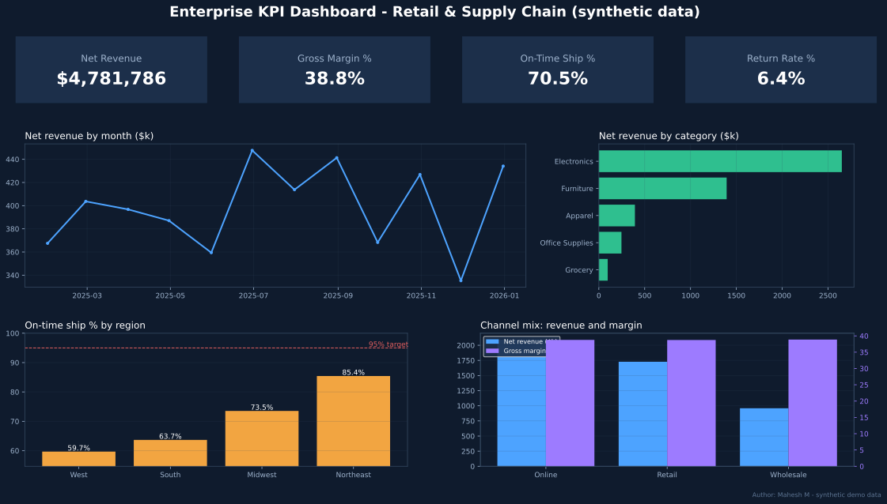

# Enterprise KPI Dashboard (Retail & Supply Chain)

A portfolio project by **Mahesh M**: a one-page executive KPI dashboard built from a shared, version-controlled metric layer, with matching Power BI DAX measures.

> **Demo project.** All data is synthetic and randomly generated (fixed seed). It does not come from any real company or employer, and the numbers are not real-world metrics.

## The idea: metrics defined once

Most reporting bugs are definition bugs - two teams compute "margin" or "on-time" differently. This project puts the definitions in [`metrics/metrics.yml`](metrics/metrics.yml) (name, description, formula, grain, format) and implements the same definitions twice:

- **Python dashboard** - `scripts/build_dashboard.py` computes each KPI from the raw order data and renders `dashboard.png` plus [`kpi_summary.md`](kpi_summary.md).
- **Power BI** - [`powerbi/measures.dax`](powerbi/measures.dax) holds the equivalent DAX measures, ready to paste into a Power BI model over the same `orders` table.

## The KPIs

| Metric | Definition |
|---|---|
| Net Revenue | Gross sales minus returned value |
| Gross Profit / Gross Margin % | Net revenue minus COGS on kept units |
| Total Orders / Average Order Value | Distinct orders; net revenue per order |
| On-Time Ship % | Ship date on or before promised date |
| Return Rate % | Returned units / ordered units |

## Dashboard



KPI cards across the top; below: monthly net-revenue trend, revenue by category, on-time ship % by region against a 95% target, and channel revenue/margin mix.

## Run it

```bash
pip install -r requirements.txt
python scripts/build_dashboard.py   # generates data/orders.csv on first run
```

Outputs:

| File | Contents |
|---|---|
| `data/orders.csv` | 4,000 synthetic orders for 2025 (generated on first run, not committed) |
| `dashboard.svg` / `dashboard.png` | The rendered one-page dashboard |
| `kpi_summary.md` | The KPI table in markdown |

## Layout

```
metrics/metrics.yml        shared metric definitions (single source of truth)
powerbi/measures.dax       DAX equivalents for Power BI
scripts/generate_data.py   deterministic synthetic order data
scripts/build_dashboard.py KPI computation + dashboard rendering
```

## Possible extensions

A dbt Semantic Layer or MetricFlow export of the same definitions, drill-through pages per region, and alerting when a KPI breaches its target.

---
Author: Mahesh M. Released under the MIT License.
